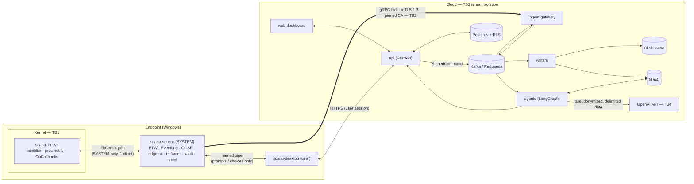
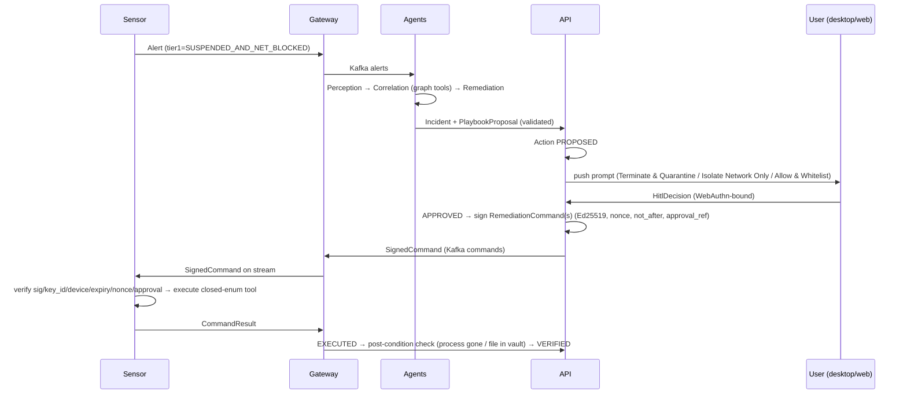

# Scanu — System Design

Hybrid EDR + AI-SIEM for consumer/prosumer PCs. Design goal: **contain and recover**, not perfect
prevention. Detect, freeze, explain, and let a human decide; every destructive step is reversible.

## 1. Components

| Component | Path | Language | Runs as | Purpose |
|---|---|---|---|---|
| `scanu_flt.sys` | `sensor/driver-win/scanu_flt` | C (WDK) | Kernel | Minifilter (file I/O, canaries, self-protect), process-create notify (pre-exec verdict), `ObRegisterCallbacks` (handle stripping) |
| `scanu-sensor` | `sensor/crates/sensor-svc` | Rust | Windows service, `LocalSystem` | ETW + Event Log collection, OCSF normalization, edge ML, Tier-1 enforcement, vault, cloud uplink |
| `sensor-core` | `sensor/crates/sensor-core` | Rust | lib | Platform traits (`EventSource`, `Enforcer`), OCSF builders, spool, canary policy |
| `edge-ml` | `edge-ml/crates/edge-ml` | Rust | lib | SHA-256 → bloom → static features → classifier (ONNX) → YARA-X → `Verdict` |
| `vault` | `sensor/crates/vault` | Rust | lib | AES-256-GCM encrypted quarantine with manifest + byte-identical restore |
| `enforcer` | `sensor/crates/enforcer` | Rust | lib | Tier-1 policy, signed-command verification (Ed25519, nonce, expiry, approval binding) |
| `scanu-desktop` | `desktop/` | Rust + TS (Tauri v2) | Interactive user | Tray, toasts, Tier-2 prompt, rollback UI. Talks to sensor via named pipe |
| `ingest-gateway` | `ingest/gateway` | Rust (tonic) | Cloud | mTLS gRPC termination, device→tenant binding, Kafka produce, command fan-out |
| `ingest-writers` | `ingest/writers` | Rust | Cloud | Kafka → ClickHouse (raw OCSF) and Neo4j (entity graph) |
| `agents` | `agents/` | Python (LangGraph) | Cloud worker | Perception → Correlation → Remediation multi-agent pipeline |
| `api` | `api/` | Python (FastAPI) | Cloud | Tenants, devices, incidents, HITL state machine, command signing, audit log |
| `web` | `web/` | TS (Next.js) | Browser | SecOps dashboard |

## 2. Component diagram & trust boundaries



| Boundary | Crosses | Controls |
|---|---|---|
| **TB1** kernel ↔ user | `FltSendMessage` port | Port SD = SYSTEM only, `MaxConnections=1`, driver verifies connecting process image is the signed sensor; messages fixed-size structs, length-checked both sides |
| **TB2** endpoint ↔ cloud | gRPC bidi | mTLS 1.3, CA pinned in sensor binary, device key non-exportable (TPM via NCrypt PCP), gateway derives `device_id`/`tenant_id` from cert — never from payload |
| **TB3** tenant ↔ tenant | All cloud stores | Postgres RLS on `tenant_id`; ClickHouse row policies + `tenant_id` first in sort key; Neo4j access only via repository functions that inject `tenant_id` |
| **TB4** telemetry ↔ LLM | OpenAI API | Untrusted data only in a delimited JSON `untrusted_data` field; strict tools; server-side JSON Schema + entity-ID guard; no free-form command output |
| **TB5** user session ↔ sensor | named pipe | Pipe DACL: SYSTEM full, interactive user read/write of *prompt/choice* messages only; choices for Tier-2 still need cloud-signed command (or local-only "resume/allow" for a process the user owns) |

## 3. Data flows

### 3.1 Telemetry (steady state)
1. Kernel/ETW/EventLog source → `RawEvent` (platform-specific) → `sensor-core::ocsf` builder → OCSF JSON.
2. Perception (edge): drop known-benign by allowlist (signed Microsoft binaries, self-noise), sample high-volume classes; ~80%+ dropped before uplink.
3. Append to local spool (SQLite WAL ring, 256 MB cap, oldest-first eviction, priority classes never evicted before low-priority).
4. Uplink drains spool in batches of ≤ 500 or 2 s → `EventBatch` on `SensorLink.Stream`.
5. Gateway stamps `device_id`/`tenant_id` from cert → Kafka `telemetry` (key = device_id).
6. Writers → ClickHouse `ocsf_events` and Neo4j `(:Process)-[:SPAWNED|WROTE|READ|CONNECTED|RESOLVED]->(...)`.

### 3.2 Detection & Tier-1 freeze (local, offline-capable)
```
file create/exec ──► SHA-256 ──► bloom(known-bad)? ── hit ──► Tier-1
                         │ miss
                         ▼
                   static features (PE/ELF: imports, sections, entropy, signature)
                         ▼
                   classifier (ONNX LightGBM; fallback linear model) ─► score
                         ▼
                   YARA-X rules ─► matches
                         ▼
                   Verdict { malicious if bloom || score ≥ 0.98 && yara≥1 || canary }
```
Canary path: minifilter sees write/rename/delete/set-info on a canary → **denies the I/O in kernel**
(`STATUS_ACCESS_DENIED`) and posts `CANARY_TRIP{pid, qpc}` → service calls `NtSuspendProcess` and adds a WFP
block filter on the process's `ALE_APP_ID` → measured latency `qpc_suspended - qpc_trip`.

Tier-1 **never kills or deletes**. It suspends + network-blocks and raises an `Alert` (`tier1` populated).

### 3.3 HITL remediation (Tier 2 → Tier 3)


### 3.4 Rollback
`RestoreFromVault{vault_id}` and `ResumeProcess`/`UnblockProcessNetwork` are first-class tools. A false-positive
rollback is a normal HITL action: `ROLLED_BACK` is terminal and audit-logged.

### 3.5 On-demand scan
1. User clicks **Quick** or **Full system scan** (web console or desktop). `POST /v1/devices/{id}/scans` creates a `scans` row (`queued`); one active scan per device (409 otherwise).
2. The API signs `StartScan{scan_id, scope}` (non-destructive, so no HITL decision is needed, but it's still signed, device-bound, and expiring) → Kafka → gateway → sensor.
3. `engine::scan` walks the roots on a background thread (never follows symlinks, skips the sensor's own data dir). It checks magic bytes cheaply, and only PE/ELF files and scripts get hash → bloom → features → model → YARA. Telemetry ingest and Tier-1 keep running.
4. Progress (`ScanProgress`, every 500 ms) → gateway → `scanu.scan-progress` → API → console. `CancelScan` stops it between files.
5. Findings raise normal alerts with `scan_id` and no process. Agents build a file-anchored incident ("Known malware found on disk: …") whose proposal is quarantine-only. **The scan itself never deletes or quarantines.**

Quick roots: per-user Downloads, Desktop, `AppData\Local\Temp`, `AppData\Roaming`, Startup, plus `ProgramData` and `Windows\Temp`. Full roots: every fixed drive.

## 4. Multi-agent pipeline (cloud)

| Node | Model tier | Tools (allowlist) | Output |
|---|---|---|---|
| Perception | fast (`SCANU_LLM_FAST`) — only for alerts the deterministic scorer can't decide | none (classification via strict JSON schema) | `TriageResult{keep, category, rationale}` |
| Correlation | reasoning (`SCANU_LLM_REASONING`) | `get_process_tree`, `get_file_lineage`, `get_network_peers` (parameterized Cypher) | `IncidentGraph` + narrative |
| Remediation | reasoning | `propose_playbook` | `PlaybookProposal` — never executed by the agent |

Guardrails (all enforced in code, not prompts):
- Telemetry enters prompts only as JSON inside `<untrusted_data>` and is pseudonymized (`redact.py`).
- Every tool call is validated against `schemas/tools/*.json` (`additionalProperties: false`), then by a guard
  that requires every `*_entity_id` to exist in the current tenant's incident subgraph.
- The LLM cannot emit Cypher, shell, file paths, PIDs, or hashes as actions — only entity IDs.
- Remediation proposals map 1:1 onto the `RemediationCommand.tool` oneof; the API, not the LLM, builds commands.

## 5. Platform parity

| Capability | Windows | Linux | macOS |
|---|---|---|---|
| Blocking file intercept | Minifilter pre-op | fanotify `FAN_*_PERM`, eBPF LSM `file_open` | ES `AUTH_OPEN`/`AUTH_EXEC` (entitlement required) |
| Pre-exec verdict | `PsSetCreateProcessNotifyRoutineEx` `CreationStatus` | fanotify `FAN_OPEN_EXEC_PERM` / LSM `bprm_check_security` | ES `AUTH_EXEC` |
| Process/thread/handle callbacks | `PsSet*NotifyRoutine`, `ObRegisterCallbacks` | eBPF tracepoints, `ptrace` LSM hooks | ES `NOTIFY_*`, no handle-strip equivalent |
| Script telemetry | ETW PowerShell 4104, WMI, CLR | eBPF uprobes on interpreters (best-effort) | ES exec args only |
| Per-process network block | WFP `ALE_APP_ID` filter (user-mode API) | cgroup v2 + eBPF `cgroup/connect4/6` | NetworkExtension content filter |
| Flow ↔ PID | ETW Kernel-Network | eBPF `inet_sock_set_state` | NetworkExtension flow metadata |
| JA3/JA4 | WFP stream callout (post-MVP) | eBPF TC/XDP | NE filter data provider |
| Anti-tamper | ObCallbacks now; PPL+ELAM after MVI | lockdown + LSM | System Extension + SIP |
| HW-backed key | NCrypt Platform Crypto Provider (TPM 2.0) | tpm2-tss | Secure Enclave (P-256 only) |

## 6. Performance budgets

| Metric | Budget | Measured by |
|---|---|---|
| Idle CPU (sensor + driver) | ≤ 2% avg over 10 min | `tests/perf/cpu.ps1` (typeperf `\Process(scanu-sensor)\% Processor Time` / cores) |
| Loaded CPU (1k file ops/s) | ≤ 5% p95 | same, with `tests/perf/fileload.ps1` |
| RSS | ≤ 150 MB | typeperf Working Set |
| Canary trip → suspended | < 100 ms (target < 10 ms) | QPC in driver message vs QPC after `NtSuspendProcess` |
| Pre-exec scoring | p99 < 50 ms, fail-open at 200 ms | `edge-ml` bench + driver timeout counter |

## 7. Wire formats
All wire contracts live in `schemas/`:
- `proto/scanu/v1/*.proto` — telemetry envelope, alerts, remediation commands, HITL, service.
- `ocsf/` — pinned OCSF version and the `scanu` extension attributes.
- `tools/*.json` — LLM tool schemas (single source; loaded by `agents` at runtime).
